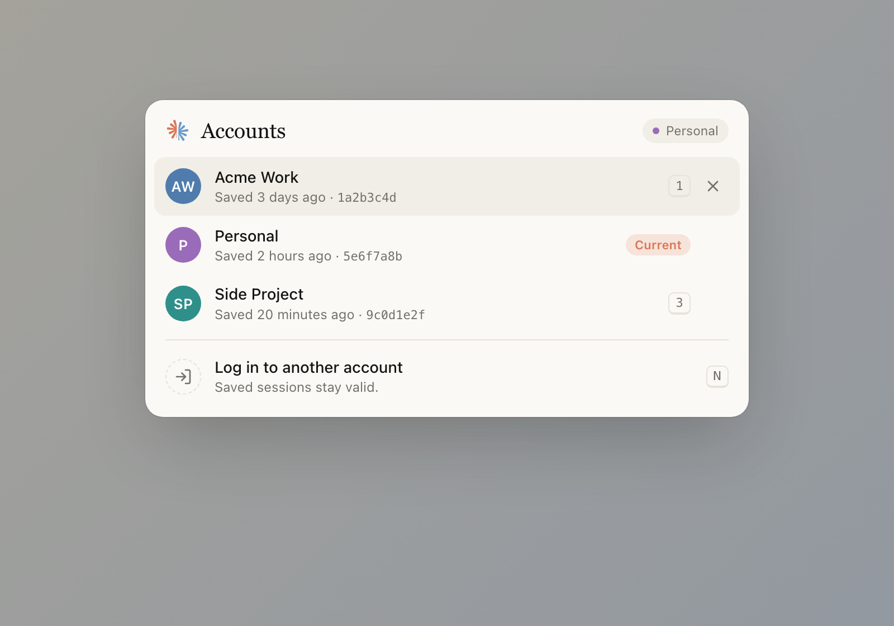

# Claude Session Switcher

Switch between several claude.ai accounts in one Chrome profile. The extension saves each login's cookies and swaps them on demand.

## Install

1. Open `chrome://extensions` and turn on **Developer mode**.
2. Click **Load unpacked** and select this folder.
3. Set the shortcut at `chrome://extensions/shortcuts` (default `Alt+Shift+C`).

## Use

- Press the shortcut (or click the toolbar icon) to open the switcher.
- Logged in to an account that is not saved yet? Press `S` and give it a name.
- Press `1`–`9` to switch accounts. Press `N` to log in to another account.
- The toolbar badge shows which account is active.

**Never click "Log out" on claude.ai.** Logout invalidates the saved session. Use **Log in to another account** instead.

## Security

Saved cookies are stored unencrypted in the extension's local storage. Anyone with access to your Chrome profile can use them. Do not share your profile folder, and remove the extension to delete all saved sessions.

Not affiliated with Anthropic.
